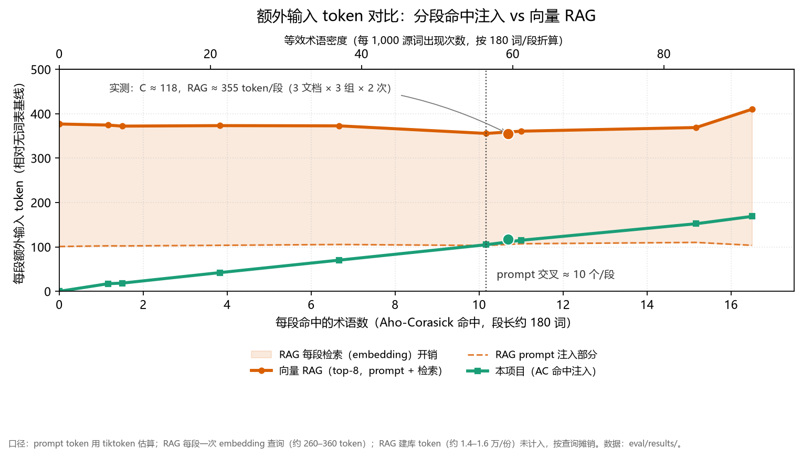

# 结论：issue #44 评测（修正版，2026-11-01）

- Provider / model：SiliconFlow / `deepseek-ai/DeepSeek-V3`
- RAG 基线：`BAAI/bge-m3` 向量检索，top-k = 8；建库 token 单列（每文档 14k–16k，一次）
- 数据：3 份合成文档，每份 **词表 ~1,200 条**（40 锚点术语 + ~1,160 干扰项）、**正文 ~2,150 词**、锚点出现 134–165 次
- 重复：每文档每组 2 次；分段 1600；全部 18 次 run 无 API 错误
- 原始数据：`results.md`、`runs.jsonl`、`summary.json`

## 1. 术语命中率（主指标）

| 组 | term 级 | occurrence 级 |
|---|---|---|
| A 无注入 | 68.5% | 43.9% |
| B 向量 RAG（top-8） | 79.7% | 54.1% |
| C 分段命中注入 | **99.6%** | **95.3%** |

- **C 相对 A：+31.1pp，相对 +45.4%**；occurrence 级 +51.4pp。
- 「识别率 +35%」按相对口径**成立且略被超过**（45.4% > 35%）；但 A 基线已有 68.5%（模型知道常见译名），幅度会随术语难度变化，不能当固定常数。
- **C 明显高于向量 RAG**（99.6% vs 79.7%）：RAG 的 top-8 检索会漏掉部分应出现术语，精确匹配不会漏。

## 2. token 开销

| 文档 | B prompt 增量 | B embedding | B 合计 | C prompt 增量 | C/B 合计 |
|---|---:|---:|---:|---:|---:|
| novel | +1,163 | +2,889 | +4,052 | +1,508 | 37.2% |
| rulebook | +1,292 | +3,025 | +4,317 | +1,419 | 32.9% |
| technical_doc | +1,318 | +3,085 | +4,403 | +1,304 | 29.6% |
| 均值 | +1,258 | +3,000 | **+4,257** | **+1,410** | **33.1%** |

- **C 的总额外开销是 RAG 基线的 33.1%（省 66.9%）**。
- 注意：**只看 prompt token 时 C 并不更省**（+1,410 vs +1,258）——本评测集术语密度高（165 次 / 2,150 词，约每段命中 9–11 个术语），C 注入的条目数超过 RAG 的 top-8。B 的成本优势被**每段一次嵌入查询**（约 300 token/段）抵消。
- **「省 99% token」不成立**。只有当每段命中的术语很少（真实文档密度低）时，C 的 prompt 增量才会显著下降：按当前每段约 140 token 的注入量估算，密度降到 1/4 时 C 的额外开销约 350 token/次运行，C/B ≈ 8%（省 ~92%）；要到 99% 需要低到每段 0–1 个命中。**99% 是低密度渐近值，不是通用结论。**

## 3. 成本曲线（token vs 术语密度）

数据：`results/cost_sweep.csv`（每个密度 6 个 ~180 词分段，prompt token 用 tiktoken，B 的查询 embedding 用 Provider usage）。横轴为每段命中术语数（副轴为等效密度），纵轴为每段额外输入 token。

- **零命中时**：C = 0；RAG 仍要每段注入 top-8 并检索一次，约 **+360 token/段**。
- **C 的斜率**：约 **10.5 token / 命中术语**；RAG 的 prompt 注入基本恒定（约 105 token），检索约 255–310 token。
- **prompt 交叉 ≈10 个命中/段**（约 55 次出现/1,000 词）：低于此值，C 的 prompt 比 RAG 的 top-8 prompt 更省；高于此值，C 的注入更大（本评测实测量约 10.9 个/段，正好在交叉点附近，prompt 118 vs 105）。
- **总额外 token 的交叉**外推约 35–40 个命中/段；在本评测集（每份 40 个锚点术语）里达不到，真实文档更达不到。因此在可实现的密度范围内，**C 的总额外开销始终低于 RAG**，但优势主要来自「省掉每段检索」，而不是「prompt 永远更小」。
- 实测点与扫描一致：C ≈118、RAG ≈355 token/段（C 为 RAG 的 33%），见图中标记。

## 4. 耗时（参考）

C 171s < A 236s < B 270s（每文档均值）。B 多出每段一次 embedding 往返；C 更快。

## 5. 对仓库描述与 README 的修订（2026-11-01 已落地）

旧描述：`Optimizes proper noun accuracy with 35% higher recognition rate and 99% token savings vs traditional RAG.`

已更新为：

> AI translation for technical docs, novels and rulebooks. Reproducible 3-document evaluation: 99.6% terminology hit rate vs 68.5% without a glossary and 79.7% with vector RAG, at about 33% of RAG's extra token cost. CLI/WebUI; Markdown/PDF/Word/EPUB/XLSX.

同步调整 topics：移除 `named-entity-recognition`，新增 `glossary` / `terminology-management` / `document-translation`。README 中英文与 CHANGELOG 亦已更新。

中文表述参考：

> 在可复现的三文档评测集（每份 ~1,200 条词表 / ~2,150 词正文，向量 RAG top-8 基线）上，分段词表注入把术语命中率从 68.5% 提升到 99.6%（+31.1pp，相对约 +45%），比向量 RAG 基线（79.7%）高 20pp；额外 token 开销约为向量 RAG 基线的 33%（省约 67%），且不产生检索调用。文档术语密度越低，token 节省比例越高。

README「关于早期数字的说明」建议补一行：评测脚本与数据见 `eval/`，结果见 `eval/results/results.md`。

## 6. 与上一版（作废）的差异

上一版把 B 做成「整表注入」，且文档仅 ~2,100 词、词表 30 条——与实际 1k–3k 词表的场景不符。修正版：

- B 改为**每段向量检索 top-8**，成本包含 embedding 查询 token；
- 词表放大到 ~1,200 条，正文 ~2,150 词；
- 结论从「省 72%（相对整表注入）」改为「省 66.9%（相对向量 RAG）」，并新增「C 质量高于 RAG 20pp」这一发现。

## 7. 局限与下一步

1. 文档为合成数据，句式模板化、术语密度偏高（对 C 的 token 不利）；下一版应加入真实体例（更长、低密度、含歧义）样本。
2. 术语命中用子串判定，未做人工逐句误译评分。
3. 单模型、2 次重复；top-k=8 只代表一种 RAG 配置，建议补 k=3/5/12 的敏感性。
4. embedding 与 chat 同 Provider；跨 Provider 只看相对量。
5. RAG 建库成本（每文档 14k–16k token）单列，生产中会摊销到大量查询。
